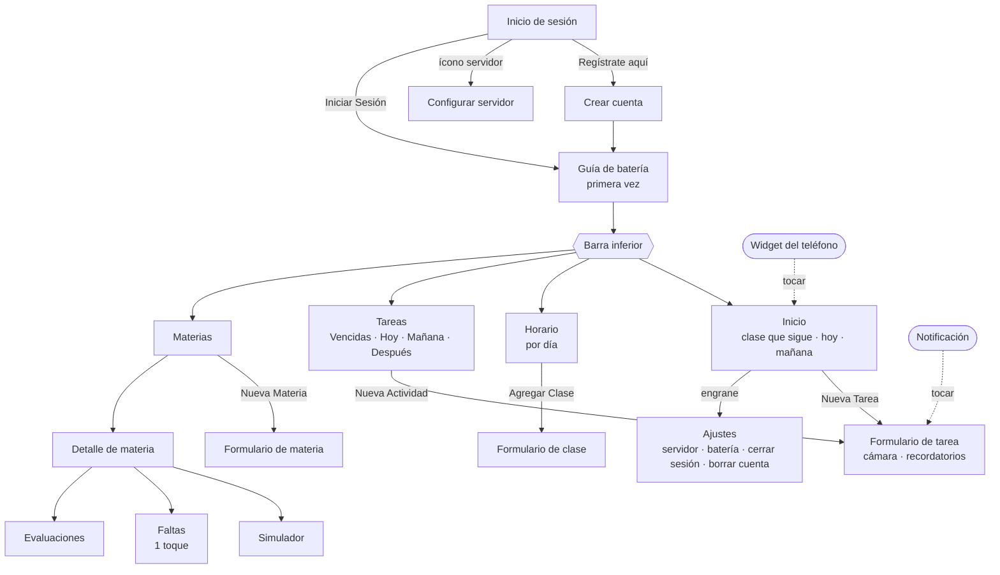

# Análisis y diseño — MiSemestre UTM

> Entregable 2: historias de usuario con criterios de aceptación, requisitos, mapa de navegación,
> bocetos, guía visual y flujo de la demostración.

## 1. Roles

Hay **un solo rol**: *estudiante*. Cada cuenta es privada; no hay administradores ni datos compartidos
entre usuarios. Por eso el control de acceso es "solo el dueño" (ver [datos-seguridad.md](datos-seguridad.md)).

## 2. Historias de usuario

| # | Historia de usuario | Criterio de aceptación (comprobable) | Prioridad |
|---|---|---|---|
| HU1 | Como estudiante, quiero **capturar una tarea en segundos durante la clase**, para no olvidar lo que dijo el profesor. | Con el horario capturado, al tocar **Nueva Tarea** la materia de la clase en curso y la fecha de su próxima clase ya vienen elegidas; basta escribir el título y tocar **Crear Tarea**. | Alta |
| HU2 | Como estudiante, quiero **adjuntar una foto del pizarrón** a la tarea, para tener las indicaciones exactas. | Al guardar la tarea con foto (cámara o galería), la foto queda asociada a esa tarea, se ve con el ícono de imagen y se puede abrir después, incluso desde la web. | Alta |
| HU3 | Como estudiante, quiero **recibir un recordatorio antes de cada entrega**, para no entregar tarde. | Con recordatorios "1 día" y "2 h" antes, llegan las dos notificaciones aunque el teléfono no tenga internet; tocar la notificación abre esa tarea. | Alta |
| HU4 | Como estudiante, quiero **registrar una falta con un toque** y que me avise cuando estoy por llegar al límite, para no perder el derecho a examen. | **Falta de hoy (1 toque)** la registra con la fecha actual; no permite dos faltas el mismo día en la misma materia; al quedar 1 falta disponible llega una notificación; las justificadas no cuentan. | Alta |
| HU5 | Como estudiante, quiero **saber cuánto necesito sacar** en lo que falta, para planear mi estudio. | En **Simulador**, con Parcial 1 = 7 (30 %), Parcial 2 = 8 (30 %), Final pendiente (40 %) y aprobatoria 8, la app indica el promedio necesario en lo pendiente y avisa si los porcentajes no suman 100 %. | Media |
| HU6 | Como estudiante, quiero **ver qué clase sigue** sin abrir la app, para llegar al salón correcto. | La pestaña **Inicio** y el **widget** del teléfono muestran materia, hora y salón de la siguiente clase y las tareas de hoy. | Media |
| HU7 | Como estudiante, quiero **usar la app sin datos**, para consultarla en el camión. | Sin conexión se puede consultar y capturar; lo capturado muestra **Pendiente sync** y desaparece la etiqueta al sincronizar con red. Nunca se muestra "guardado en el servidor" si no se envió. | Alta |
| HU8 | Como estudiante, quiero que **nadie más vea mis datos**, para proteger mi información. | Un segundo usuario no puede leer, editar ni borrar materias, tareas o fotos ajenas (la API responde 404). | Alta |
| HU9 | Como estudiante, quiero **borrar mi cuenta y todos mis datos**, para controlar mi información. | **Borrar mi cuenta** exige escribir BORRAR; con conexión elimina todo del servidor y del teléfono; sin conexión muestra error y no borra nada. | Baja |

## 3. Requisitos

### Funcionales (qué hace la app)

| ID | Requisito |
|---|---|
| RF1 | Registro e inicio de sesión con correo y contraseña. |
| RF2 | Alta, edición y baja de materias con límite de faltas, calificación aprobatoria y escala. |
| RF3 | Horario semanal por materia, con opción de repetir la clase en varios días. |
| RF4 | Tareas y exámenes con fecha/hora, descripción, foto adjunta y recordatorios configurables. |
| RF5 | Registro de faltas (justificadas o no) y alertas por umbral. |
| RF6 | Evaluaciones con porcentaje y simulador de calificación final. |
| RF7 | Pantalla de inicio con clase actual/siguiente y pendientes de hoy y mañana; widget de pantalla de inicio. |
| RF8 | Funcionamiento sin conexión y sincronización con el servidor. |
| RF9 | Ajustes: servidor, guía de batería, cerrar sesión y borrar cuenta. |

### No funcionales

| ID | Tipo | Requisito |
|---|---|---|
| RNF1 | Seguridad | Contraseñas con bcrypt; token JWT de 30 días guardado en almacenamiento seguro del teléfono (`flutter_secure_storage`). |
| RNF2 | Seguridad | Toda consulta en el servidor filtra por el usuario dueño; ningún secreto (JWT_SECRET, claves de firma) va en el APK ni en el repositorio. |
| RNF3 | Seguridad | Límite de intentos: 10 logins fallidos en 15 min por IP. |
| RNF4 | Seguridad | Fotos: solo JPG/PNG/WEBP/HEIC, máximo 5 MB, accesibles solo por su dueño. |
| RNF5 | Estabilidad | Un error de red nunca deja datos a medias: lo no enviado queda marcado como pendiente. |
| RNF6 | Usabilidad | Flujo principal en ≤ 3 toques; textos en español; botones de tamaño táctil; mensajes de error claros. |
| RNF7 | Rendimiento | Las pantallas leen de la base local (SQLite), así que abren al instante aun sin red. |
| RNF8 | Compatibilidad | Android con soporte de notificaciones exactas; guía para fabricantes que restringen segundo plano. |

### Datos que **no** pedimos

No pedimos matrícula, teléfono, ubicación ni foto de perfil: no hacen falta para el beneficio central.

## 4. Mapa de navegación



## 5. Bocetos de las pantallas esenciales

```
┌──────────────────────┐ ┌──────────────────────┐ ┌──────────────────────┐
│ MiSemestre UTM    ⚙ ⟳│ │ ← Nueva Tarea        │ │ ← Programación Móvil │
│──────────────────────│ │──────────────────────│ │ Simulador│Faltas│Eval│
│ AHORA                │ │ (•)Tarea  ( )Examen  │ │──────────────────────│
│ ▌Programación Móvil  │ │ Materia [Prog. Móv ▼]│ │ Faltas: 3 de 5       │
│ ▌07:00–09:00  Lab 2  │ │ Título [___________] │ │ ███████░░░  Quedan 2 │
│ SIGUE                │ │ Entrega [lun 24][⏰] │ │                      │
│ ▌Bases de Datos 09:00│ │ Foto  [📷 Adjuntar]  │ │ [ Falta de hoy  ]    │
│──────────────────────│ │ Recordar:            │ │ [ Otra fecha    ]    │
│ Pendientes de hoy    │ │ [1 día✓][2 h✓][30m]  │ │──────────────────────│
│ ☐ Práctica 3   🖼    │ │                      │ │ 20/11  ☐ justificada │
│ ☐ Examen U2  ⚑      │ │                      │ │ 13/11  ☑ justificada │
│ Para mañana          │ │                      │ │ 06/11  ☐ justificada │
│ ☐ Lectura cap. 4     │ │ [   Crear Tarea   ]  │ │                      │
│              [+ Tarea]│ │                      │ │                      │
│ Inicio Horario Tareas│ │                      │ │                      │
└──────────────────────┘ └──────────────────────┘ └──────────────────────┘
      Inicio                 Captura rápida             Faltas en 1 toque
```

```
┌──────────────────────┐   ┌───── Widget del teléfono ─────┐
│ Simulador            │   │ SIGUE · 09:00 · Aula 14        │
│ Asegurado: 4.5 / 10  │   │ Bases de Datos                 │
│ Necesitas: 8.75 en   │   │ Hoy: Práctica 3 · Examen U2    │
│ lo que falta (40 %)  │   └────────────────────────────────┘
│ ¿Y si saco...? ──●── │
│ → Final: 8.2 ✓       │
└──────────────────────┘
```

## 6. Guía visual

| Elemento | Valor | Uso |
|---|---|---|
| Vino UTM | `#7A1B29` | Color primario, barra superior, botones principales, ícono |
| Vino oscuro | `#56111C` | Títulos, texto sobre fondo claro |
| Dorado / ocre | `#D49E35` | Acentos, banda del ícono, destacados |
| Superficie | `#F9F9FB` | Fondo de pantallas |
| Texto | `#1E293B` / atenuado `#64748B` | Contenido / ayudas |
| Materias | 10 colores (vino, azul, esmeralda, ámbar, púrpura, rojo, cian, índigo, rosa, grafito) | Identificar materias en horario y tareas |

- **Tipografía:** Roboto (fuente del sistema Android, Material 3), negritas para títulos; tamaño base 14–16.
- **Ícono:** calendario blanco con banda dorada y palomita vino sobre fondo vino (`app/assets/icon/`).
- **Estados definidos:** cargando (indicador circular), lista vacía (mensaje + botón para crear), éxito (SnackBar),
  sin conexión (etiqueta **Pendiente sync** y mensaje de error controlado), error del servidor (mensaje de la API tal cual).
- **Accesibilidad:** contraste alto (vino sobre blanco), áreas táctiles ≥ 48 dp, textos que se acomodan si el
  sistema agranda la letra.

## 7. Flujo que se demostrará

1. Abrir la app (cuenta de demo `demo@utm.test`, ver [cuentas-prueba.md](cuentas-prueba.md)) → Inicio muestra la clase que sigue.
2. **Nueva Tarea** → título → **Adjuntar → Tomar foto** del pizarrón → recordatorio 10 min → **Crear Tarea**.
3. Mostrar la tarea en **Tareas** con su foto; abrir la web y ver la misma tarea y foto.
4. **Materias → Programación Móvil → Faltas → Falta de hoy**: aparece la alerta "te queda 1 falta".
5. **Simulador**: mover "¿Y si saco...?".
6. Activar modo avión → crear tarea → aparece **Pendiente sync** → quitar modo avión → **Sincronizar ahora**.
7. Casos de validación: login con correo inválido; segundo usuario no ve los datos.
8. Esperar el recordatorio y tocar la notificación → abre la tarea.
