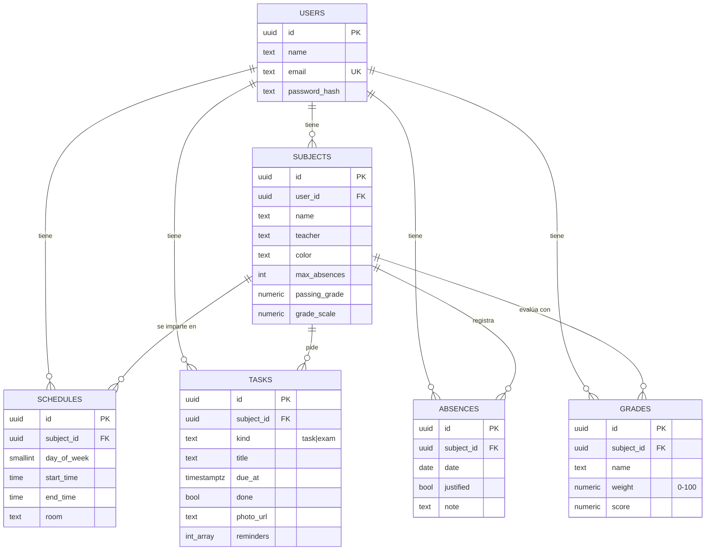

# Datos y seguridad — MiSemestre UTM

> Entregable 5: esquema de datos, permisos y configuración reproducible **sin secretos**.

## 1. Decisión técnica: API propia (Node + PostgreSQL) en lugar de Supabase

Los lineamientos piden Supabase para "autenticación y/o base de datos y almacenamiento, **según las
necesidades del proyecto**". El equipo construyó la web y la app sobre una **API propia** porque:

- La **sincronización sin conexión** necesita una ruta a la medida (`GET /api/sync?since=`) y borrado lógico
  en todas las tablas; tenerla en nuestro servidor nos dejó controlar el orden y los conflictos.
- La **web y la app comparten el mismo contrato** (`docs/api.md`), así que una sola capa de reglas protege a ambos clientes.
- Cumple lo mismo que pediría Supabase con RLS: el control de acceso se aplica **en el servidor**, no ocultando botones.

| Lo que pediría con Supabase | Cómo lo cumplimos |
|---|---|
| Supabase Auth | Registro/login propios: bcrypt (costo 10) + JWT de 30 días |
| Políticas RLS "solo el dueño" | Cada consulta SQL lleva `WHERE user_id = $usuario_del_token`; recursos ajenos responden 404 |
| Storage con acceso privado | Fotos en carpeta del servidor con nombre `<userId>-<uuid>`; solo el dueño autenticado las descarga |
| Nunca la `service_role` key en la app | Ningún secreto en el APK: la app solo guarda el token del propio usuario |

> Migrar a Supabase queda como trabajo de una siguiente versión (ver la sección 6).

## 2. Modelo de datos

- Todas las tablas de datos tienen `user_id`, `created_at`, `updated_at` y `deleted_at` (borrado lógico para la sincronización).
- El esquema completo e idempotente está en [`backend/src/schema.sql`](../backend/src/schema.sql).
- En el teléfono se replica en **SQLite** con una columna extra `sync_status`.

## 3. Quién puede ver qué

| Dato | Quién lo ve / modifica | Dónde se aplica la regla |
|---|---|---|
| Cuenta (nombre, correo) | Solo el propio usuario | Middleware JWT + `/api/me` |
| Materias, horario, tareas, faltas, evaluaciones | Solo el dueño | `WHERE user_id = $1` en cada consulta de `routes/resource.js` |
| Crear algo en una materia | Solo si la materia es del usuario | Se verifica `subjects.user_id` antes de insertar (404 si es ajena) |
| Fotos | Solo el dueño | `routes/uploads.js` compara el prefijo del archivo con el id del token |
| Contraseña | Nadie (solo el hash bcrypt) | Nunca se devuelve en ninguna respuesta |

**Comprobado con dos usuarios** en `backend/test/smoke.js`: un segundo usuario no puede leer, editar ni borrar
tareas/materias ajenas, crear clases o tareas en una materia ajena, ni descargar la foto ajena; la tarea original sigue intacta.

## 4. Validaciones y protecciones

| Protección | Detalle |
|---|---|
| Validación de datos | Esquemas **zod** en el servidor (`schemas.js`) + validadores en los formularios de Flutter |
| Fuerza bruta | 10 logins fallidos / 15 min y 30 registros / 1 h por IP (`express-rate-limit`) → 429 |
| Encabezados HTTP | `helmet` |
| CORS | Solo los orígenes de `CORS_ORIGIN` |
| Fotos | JPG, PNG, WEBP o HEIC; máximo 5 MB; nombre aleatorio; sin rutas relativas (`path.basename`) |
| Token en el teléfono | `flutter_secure_storage` (Keystore de Android), no en texto plano |
| Borrado de cuenta | Confirmación escribiendo BORRAR; elimina datos y fotos del servidor y limpia el teléfono |

## 5. Permisos de Android y para qué se usan

| Permiso | Para qué | Si se niega |
|---|---|---|
| `INTERNET` | Hablar con la API | La app funciona sin conexión con lo guardado |
| `POST_NOTIFICATIONS` | Recordatorios de entregas y alertas de faltas | No llegan avisos; el resto funciona |
| `SCHEDULE_EXACT_ALARM` / `USE_EXACT_ALARM` | Que el recordatorio llegue a la hora exacta | Pueden llegar con retraso |
| `RECEIVE_BOOT_COMPLETED` | Reprogramar recordatorios al reiniciar el teléfono | Se pierden tras reiniciar hasta abrir la app |
| Cámara / galería | Se usan mediante el **selector del sistema** (`image_picker`) solo al tocar **Adjuntar** | No se adjunta foto |

No se pide ubicación, contactos ni almacenamiento completo.

## 6. Configuración reproducible sin secretos

| Archivo | En Git | Contenido |
|---|---|---|
| `backend/.env.example` | ✅ | Plantilla: `PORT`, `DATABASE_URL`, `JWT_SECRET` (valor de ejemplo), `CORS_ORIGIN` |
| `backend/.env` | ❌ (`.gitignore`) | Valores reales; `JWT_SECRET` largo y aleatorio |
| `web/.env.example` | ✅ | URL de la API |
| `app/android/key.properties` | ❌ | Contraseñas y ruta de la clave de firma |
| `*.jks` / `*.keystore` | ❌ | Clave de firma, guardada **fuera** del repositorio |
| `backend/uploads/*` | ❌ | Fotos de usuarios |
| `*.apk` | ❌ | Se publica en *Releases*, no en el código |

Pasos para levantar todo: ver el [README](../README.md). Firma del APK: [apk-firma.md](apk-firma.md).

## 7. Fuera del alcance (siguiente versión)

- Migrar autenticación, base y fotos a **Supabase** (Auth + RLS + Storage) para tener servidor en la nube sin mantenerlo.
- Servir la API con **HTTPS** en un hosting (hoy en red local se usa HTTP; por eso `usesCleartextTraffic`).
- Recuperación de contraseña por correo.
