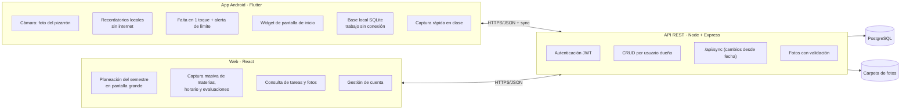

# Web vs. móvil — qué aporta la app (Modalidad B)

> Entregable 9. La app **no** es la web dentro de un WebView ni una copia de sus pantallas: es un cliente
> nativo con base local propia y funciones que el navegador no puede ofrecer.

## Diagrama del ecosistema

## Comparación

| Capacidad | Web | App móvil | Por qué importa |
|---|---|---|---|
| Fotografiar el pizarrón y ligarlo a la tarea | Solo subir archivo existente | **Cámara directa** desde el formulario | Se captura en el momento, en el salón |
| Recordatorios antes de entregas | ✗ (el navegador cerrado no avisa) | **Notificaciones programadas en el teléfono**, llegan sin datos y abren la tarea | Es el beneficio central |
| Alerta "te queda 1 falta" | ✗ | **Notificación al registrar** la falta | Evita perder derecho a examen |
| Sin conexión | ✗ | **SQLite local + cola de pendientes** | Camión, pasillo, sin datos |
| Ver la siguiente clase sin abrir nada | ✗ | **Widget** de pantalla de inicio | Consulta en 1 segundo |
| Captura en 3 toques | Formulario completo | Materia y fecha **prellenadas** con la clase en curso | Uso en movimiento |
| Planear el semestre (capturar todo el horario) | **Pantalla grande, teclado** | Posible, más lento | Cada plataforma hace lo que mejor sabe |

## Qué comparten

- **Mismos usuarios:** la cuenta se crea en cualquiera de las dos y el mismo correo/contraseña funciona en ambas.
- **Mismos datos:** materias, horario, tareas, faltas, evaluaciones y fotos viven en la misma base PostgreSQL detrás de la API.
- **Mismas reglas:** la API valida permisos y datos para los dos clientes (ver [datos-seguridad.md](datos-seguridad.md)).

## Cómo se sincronizan los cambios

1. La app guarda todo primero en **SQLite** con un estado (`synced`, `pending_create`, `pending_update`, `pending_delete`).
2. Al sincronizar, envía los pendientes en orden (una materia nueva antes que sus tareas) y luego pide
   `GET /api/sync?since=<fecha>` para traer lo que cambió desde la web u otro teléfono.
3. Los borrados son **lógicos** (`deleted_at`), así el teléfono se entera de lo que se borró en la web.
4. Si hay un cambio local pendiente, lo que viene del servidor **no lo sobrescribe** (prueba automatizada).

## Qué pasa cuando falla la conexión

- La operación se guarda localmente con la etiqueta **Pendiente sync**; nunca se muestra como enviada.
- Las fotos se suben en el siguiente sincronizado y entonces se actualiza la tarea.
- Operaciones que **requieren** el servidor (iniciar sesión, borrar cuenta) muestran un error claro y no hacen cambios parciales.
